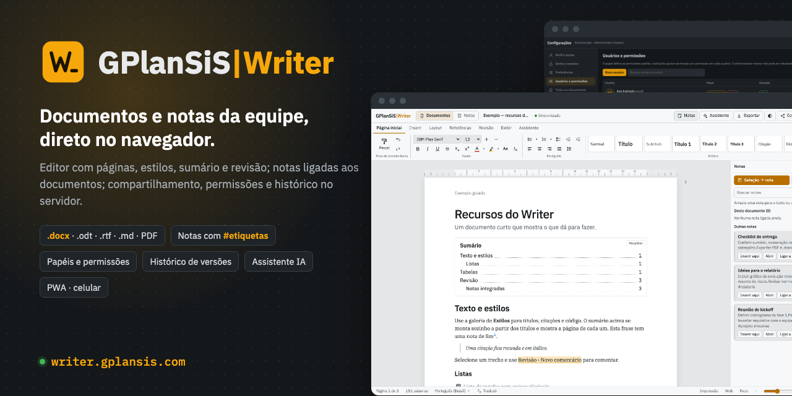
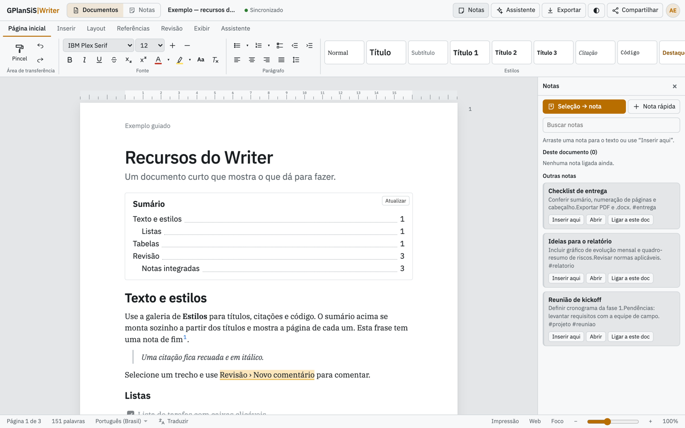
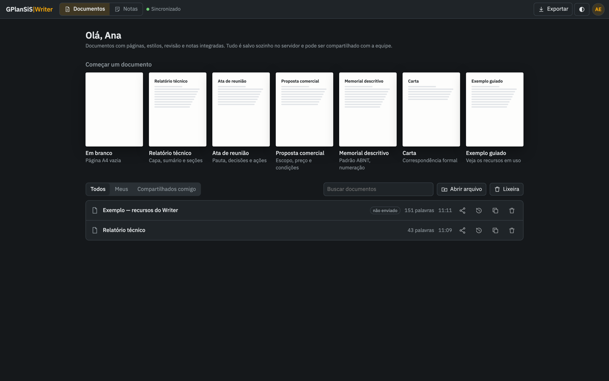
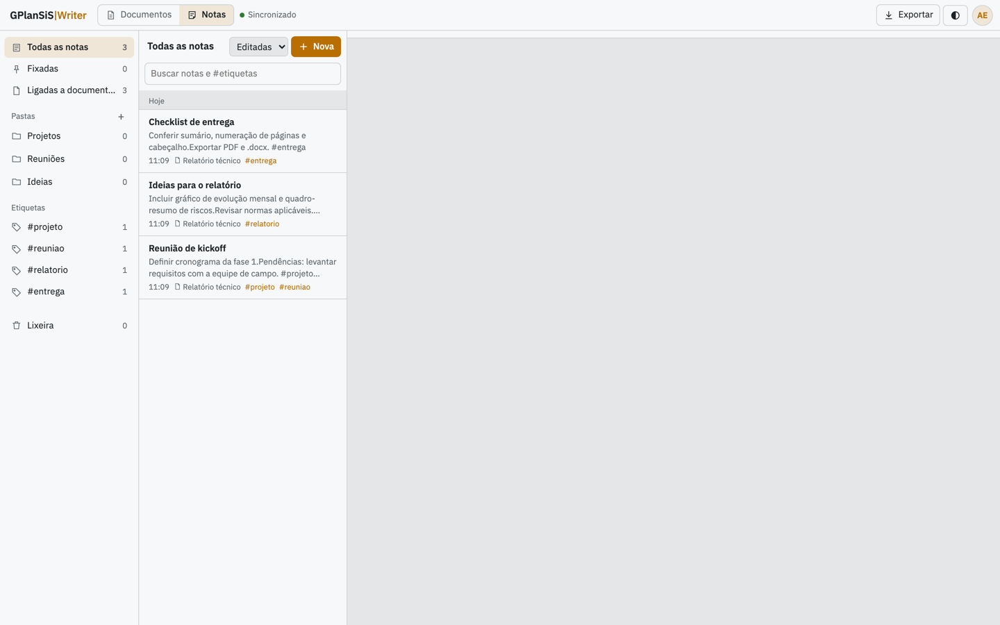
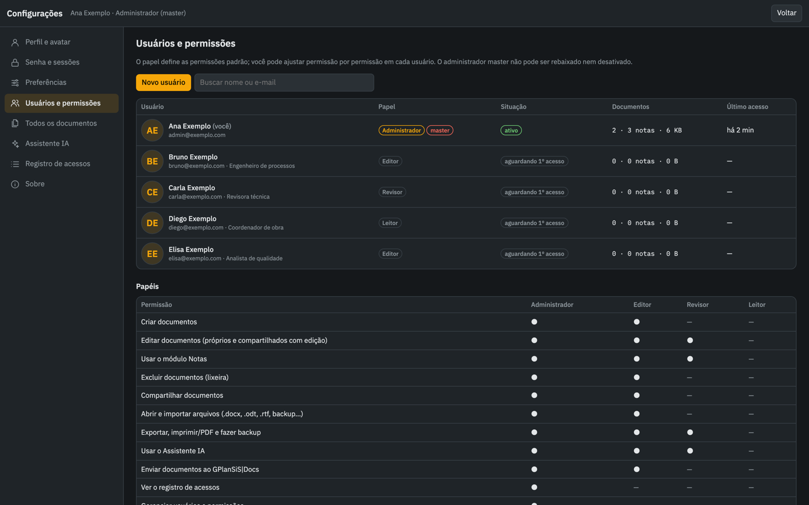
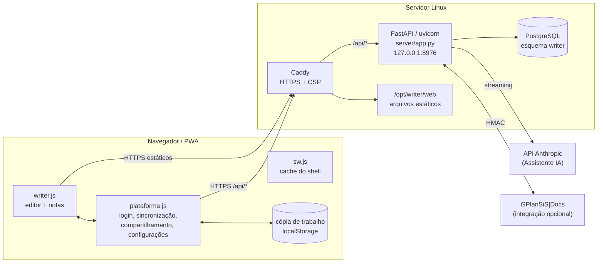

<p align="center">
  <a href="https://writer.gplansis.com"></a>
</p>

<h1 align="center">GPlanSiS|Writer</h1>

<p align="center">
  <b>Editor de documentos no estilo Word com módulo de Notas integrado — no navegador, com login, compartilhamento e histórico no servidor.</b>
</p>

<p align="center">
  <a href="https://writer.gplansis.com"></a>
  
  <a href="LICENSE"><">
</p>
<p align="center">
  
  
  
  
  
</p>

<p align="center">
  <a href="https://writer.gplansis.com"><b>➜ Acesse writer.gplansis.com</b></a>
  &nbsp;·&nbsp; <a href="#como-rodar-localmente">Rodar localmente</a>
  &nbsp;·&nbsp; <a href="#contribua">Contribua</a>
  &nbsp;·&nbsp; <a href="docs/operacao.md">Manual de operação</a>
</p>

---

## O que é

O **GPlanSiS|Writer** é o editor de documentos e notas da GPlanSiS. Ele roda inteiro no navegador — computador, tablet ou celular — e oferece o que se espera de um processador de texto: páginas A4 com régua, estilos, sumário automático, notas de fim, comentários, controle de alterações, modelos prontos e importação/exportação de **.docx**, **.odt**, **.rtf**, **Markdown**, **HTML** e **PDF**.

Existe em duas formas, ambas neste repositório:

| Forma | Onde | Para quê |
|---|---|---|
| **Versão servidor** (a que está no ar) | `web/` + `server/` | Login, documentos e notas guardados em PostgreSQL, compartilhamento, papéis e permissões, histórico de versões, lixeira, trava de edição, Assistente IA e integração com o GPlanSiS\|Docs. |
| **Versão arquivo único** | `standalone/` | Um HTML que abre com dois cliques, sem instalação nem backend; os dados ficam no armazenamento do navegador. A versão *offline* traz fontes e bibliotecas embutidas. |

## Funcionalidades

**Editor**
- Páginas com régua, margens e tamanho de papel, cabeçalho e rodapé, “Página X de Y”, quebra de página.
- Galeria de estilos (Título, Subtítulo, Título 1–3, Citação, Código, Destaque…), listas, lista de tarefas, tabelas, imagens (fotos grandes são reduzidas automaticamente).
- Sumário automático com número de página, notas de fim, comentários e controle de alterações.
- Localizar e substituir, pincel de formatação, modo foco, visualização Impressão/Web, zoom, ler em voz alta.
- Modelos: relatório técnico, ata de reunião, proposta comercial, memorial descritivo (padrão ABNT), carta e um exemplo guiado.

**Formatos**

| Formato | Abrir | Salvar |
|---|:-:|:-:|
| Word .docx | ✔ | ✔ |
| Word 97–2003 .doc | ✔ (texto e estrutura) | ✔ (HTML do Word) |
| OpenDocument .odt | ✔ | ✔ |
| Rich Text .rtf | ✔ | ✔ |
| Texto .txt / Markdown .md / HTML | ✔ | ✔ |
| CSV / TSV (vira tabela) | ✔ | — |
| PDF (pela impressão do navegador) | — | ✔ |
| Backup completo .json | ✔ | ✔ |

**Notas**
- Módulo de notas com pastas, etiquetas `#assim`, fixadas, lixeira e busca.
- Notas ligadas a documentos: painel lateral no editor com “Seleção → nota”, “Inserir aqui” e arrastar para o texto. Nota rápida em `Ctrl+Shift+N`.

**Equipe (versão servidor)**
- Login por e-mail e senha, senha temporária com troca obrigatória, bloqueio por tentativas, sessões revogáveis.
- Papéis **Administrador, Editor, Revisor e Leitor**, com ajuste permissão por permissão (criar, editar, notas, excluir, compartilhar, importar, exportar/imprimir, IA, enviar ao Docs, auditoria, usuários). As permissões de gravação são conferidas no servidor.
- Compartilhamento com toda a equipe ou por pessoa, em leitura ou edição; **trava de edição** (quem abre primeiro edita, os outros acompanham e podem assumir).
- Gravação automática com controle otimista de versão; em conflito, nada se perde (a sua versão vira uma cópia “conflito”).
- Histórico de até **40 versões** por documento e lixeira de **30 dias**.
- Trabalho sem conexão: uma cópia de trabalho fica no navegador e é enviada quando a rede volta.
- Configurações: perfil com avatar, preferências (tema, página e margens padrão), usuários e permissões, visão de governança de todos os documentos, registro de acessos.
- **Assistente IA** (Anthropic): o administrador cola a chave no painel; ela fica cifrada no banco e nunca volta ao navegador; respostas em streaming.
- **Integração com o GPlanSiS|Docs**: envia PDF + .docx para a lista mestra de um projeto, acompanha revisão e comentários e permite entrada única entre os sistemas (HMAC).
- **PWA**: instalável no computador, Android e iPhone, com layout próprio para celular.

## Telas

| Editor com painel de notas | Início (tema escuro) |
|---|---|
|  |  |
| **Módulo Notas** | **Usuários e permissões** |
|  |  |

<sub>Capturas feitas numa instalação local com usuários e conteúdo fictícios.</sub>

## Arquitetura



- O **front** é JavaScript puro, sem build: `index.html` carrega `writer.js`/`writer.css` (o editor) e `plataforma.js`/`plataforma.css` (a camada de equipe). A CSP é `script-src 'self'` — nada de script inline.
- A **API** é um único arquivo FastAPI (`server/app.py`) com sessão por cookie HttpOnly, proteção CSRF por cabeçalho próprio (`x-writer: 1`) e o esquema SQL idempotente (`server/schema.sql`) aplicado a cada partida.
- Em produção, o **Caddy** serve os estáticos e repassa `/api/*` ao uvicorn, que roda como serviço systemd sem privilégios.

## Stack

| Camada | Tecnologia |
|---|---|
| Front | HTML, CSS e JavaScript sem framework · fontes IBM Plex · [JSZip](https://stuk.github.io/jszip/) 3.10.1 · [Mammoth](https://github.com/mwilliamson/mammoth.js) 1.6.0 |
| API | Python 3 · FastAPI · uvicorn · psycopg 3 (+ pool) · cryptography (Fernet) · httpx · SDK `anthropic` |
| Dados | PostgreSQL (esquema `writer`; produção em 16, testado localmente também em 14) |
| Produção | Caddy · systemd · Linux |
| Alternativa estática | nginx em Docker atrás do Traefik (`deploy/estatico/`) |

## Como rodar localmente

### Só o editor, sem servidor

Abra `standalone/GPlanSiS-Writer-offline.html` no Chrome, Edge, Safari ou Firefox. Pronto.

### Versão completa (front + API)

Pré-requisitos: Python 3.11+ e um PostgreSQL acessível.

```bash
# 1. banco
createdb writer                      # ou: create database writer; com o usuário que preferir

# 2. ambiente Python
python3 -m venv .venv
.venv/bin/pip install -r server/requirements.txt

# 3. variáveis (valores fictícios para desenvolvimento)
export WRITER_DSN="postgresql://$USER@127.0.0.1:5432/writer"
export WRITER_MASTER="admin@exemplo.com"
export WRITER_COOKIE_SEGURO=0        # cookie também por http://localhost

# 4. primeiro administrador (imprime uma senha temporária)
(cd server && ../.venv/bin/python app.py criar-admin admin@exemplo.com --nome "Admin Local")

# 5. servidor de desenvolvimento: API + arquivos de web/ num processo só
(cd server && ../.venv/bin/uvicorn --app-dir ../dev local:app --port 8976 --reload)
```

Abra <http://localhost:8976>, entre com o e-mail e a senha temporária e defina a nova senha. O esquema do banco é criado sozinho na primeira partida.

> `dev/local.py` só existe para desenvolvimento: ele importa a API de produção sem alterá-la e monta `web/` na raiz, imitando o `try_files` do Caddy. Em produção quem serve os estáticos é o Caddy.

O Assistente IA precisa de uma chave da Anthropic (colada em **Configurações › Assistente IA** ou em `ANTHROPIC_API_KEY`) e de `WRITER_SEGREDO` para cifrá-la. A integração com o GPlanSiS|Docs fica desligada enquanto `WRITER_DOCS_SEGREDO` estiver vazio.

### Publicar num servidor

Produção: Linux com PostgreSQL e Caddy (o bloco `deploy/vps/writer.caddy` importa um snippet `seguranca_hub` definido no Caddyfile principal — crie o seu ou remova a linha).

```bash
WRITER_HOST=<alias-ssh-com-root> WRITER_MASTER=<email-do-admin> WRITER_MASTER_NOME="Nome" \
  bash deploy/vps/publicar.sh
```

O script confere a sintaxe, monta o pacote, versiona os links de CSS/JS, envia ao servidor e roda `instalar.remoto.sh`, que faz backup da versão anterior, atualiza o venv, cria o `.env` na primeira vez (gerando `WRITER_SEGREDO`), instala o serviço systemd e o bloco do Caddy (validando antes de recarregar) e confere `/api/saude`. O banco nunca é tocado por uma publicação. Detalhes, rollback e PWA em [docs/operacao.md](docs/operacao.md).

## Estrutura de pastas

```text
.
├── web/                    front da versão servidor (sem build)
│   ├── index.html          shell: tela de acesso + editor
│   ├── writer.js / .css    o editor e o módulo Notas
│   ├── plataforma.js / .css  login, sincronização, compartilhamento, configurações
│   ├── sw.js · pwa.js · manifest.webmanifest · ícones   PWA
│   └── vendor/             JSZip e Mammoth servidos pelo próprio domínio
├── server/
│   ├── app.py              API FastAPI (auth, documentos, notas, IA, Docs, CLI criar-admin)
│   ├── schema.sql          esquema PostgreSQL idempotente
│   └── requirements.txt
├── dev/local.py            servidor de desenvolvimento (API + web/ num processo)
├── standalone/             versões arquivo único (offline 1,2 MB e online 0,2 MB)
├── deploy/
│   ├── vps/                publicar.sh, instalar.remoto.sh, writer.service, writer.caddy
│   └── estatico/           nginx + Docker Compose para a versão estática atrás do Traefik
├── docs/operacao.md        manual de operação (formatos, atalhos, deploy, PWA, integração)
└── .env.example            variáveis da API com valores fictícios
```

## Variáveis de ambiente

| Variável | Para quê |
|---|---|
| `WRITER_DSN` | Conexão PostgreSQL |
| `WRITER_MASTER` | E-mail do administrador master |
| `WRITER_SESSAO_HORAS` | Duração da sessão (padrão 12) |
| `WRITER_COOKIE_SEGURO` | `1` cookie só em HTTPS; `0` para localhost |
| `WRITER_SEGREDO` | Chave Fernet que cifra a chave da IA no banco |
| `ANTHROPIC_API_KEY` | Chave reserva do Assistente IA (opcional) |
| `WRITER_IA_MODELO` | Modelo padrão do Assistente |
| `WRITER_DOCS_SEGREDO` | Segredo HMAC compartilhado com o GPlanSiS\|Docs (vazio = integração desligada) |
| `WRITER_DOCS_URL` · `WRITER_DOCS_API` · `WRITER_URL` | Endereços usados pela integração |

Modelo completo em [`.env.example`](.env.example). **Nunca** envie um `.env` real ao repositório.

## Contribua

O Writer é usado de verdade no dia a dia e tem muito espaço para crescer. Toda ajuda é bem-vinda — de quem programa, de quem escreve documentação e de quem só testa e conta o que encontrou.

**Onde dá para ajudar**
- 🧪 **Fidelidade de importação/exportação** — .docx de terceiros com caixas de texto e seções múltiplas, .odt complexos, RTF.
- 📄 **Paginação** — hoje ela é por bloco: um parágrafo maior que meia página atravessa a quebra.
- 📝 **Notas de rodapé** de verdade (hoje são notas de fim).
- ♿ **Acessibilidade** — navegação por teclado, leitores de tela, contraste.
- 📱 **Celular e tablet** — o layout `[celular]` no fim de `writer.css` aceita melhorias.
- 🧰 **Testes automatizados** — a API ainda não tem suíte de testes (pytest + PostgreSQL efêmero seria um ótimo começo).
- 🌐 **Documentação** — guias de uso, exemplos de modelos, traduções.

**Boas primeiras issues**
- Escrever testes para os endpoints de autenticação (`/api/auth/*`) e de permissões.
- Adicionar um modelo de documento novo (ex.: ofício, procedimento operacional).
- Melhorar mensagens de erro da importação de arquivos.
- Criar um `docker-compose` de desenvolvimento com PostgreSQL + API.

Leia o [guia de contribuição](CONTRIBUTING.md), o [código de conduta](CODE_OF_CONDUCT.md) e abra uma [issue](../../issues/new/choose) antes de mudanças grandes. Vulnerabilidades: siga a [política de segurança](SECURITY.md) — não abra issue pública.

## Licença

Código próprio sob a **[licença MIT](LICENSE)** — Copyright (c) 2026 GPlanSiS.

Componentes de terceiros mantêm suas licenças: IBM Plex (SIL Open Font License 1.1), JSZip 3.10.1 (MIT ou GPLv3, à escolha), Mammoth 1.6.0 (BSD-2-Clause); no servidor, FastAPI (MIT), uvicorn (BSD-3-Clause), psycopg 3 (LGPL-3.0), cryptography (Apache-2.0 ou BSD), httpx (BSD-3-Clause) e o SDK `anthropic` (MIT).

## Créditos

Desenvolvido pela **[GPlanSiS](https://gplansis.com)**. Contato: [contato@gplansis.com](mailto:contato@gplansis.com).
